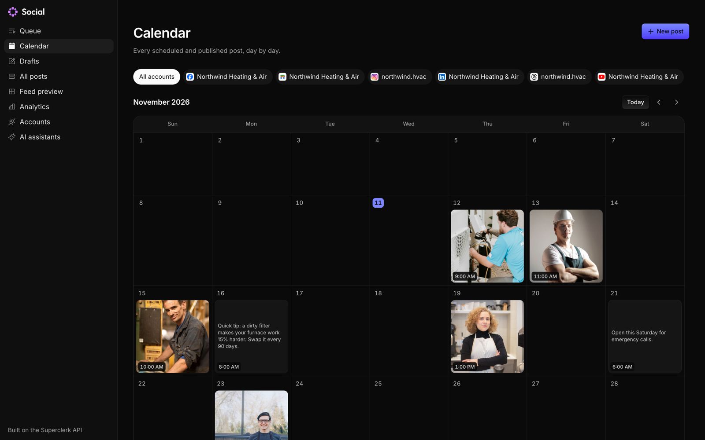

# Superclerk Social

A free, open-source social media scheduler. Write a post once and schedule it to Instagram, Facebook, LinkedIn, Threads, TikTok, YouTube and Google Business Profile.



It's built on the [Superclerk API](https://docs.superclerk.com), so there's no database to run and no developer app to register with each network. You connect your accounts through Superclerk, and your posts live in your Superclerk workspace.

## What you get

- A queue, a calendar, drafts and an Instagram feed preview
- One composer for every network, with per-network captions, media and settings
- A media library
- Analytics per account and per post
- Choose which pages and profiles each account posts to
- An MCP server, so Claude Code, Cursor, VS Code or Codex can draft and schedule posts for you

## Run it

You need [Bun](https://bun.sh) and a Superclerk API key: sign up at [superclerk.com](https://superclerk.com), then create one with Full access under Settings, Developer API.

```sh
bun install
cp .env.example .env   # add your SUPERCLERK_API_KEY
bun run dev
```

Open <http://localhost:3000>.

To run it in production:

```sh
bun run build
bun run start
```

It answers only on your own computer unless you set `HOST`. To put it on a server, also set `APP_PASSWORD`: anyone who can open the app can post to your accounts.

## Use it with AI assistants

The app is also an MCP server, at `/mcp`. Its **AI assistants** page has the commands for each client, such as the one below, and on your own computer one-click installs for Cursor and VS Code.

```sh
claude mcp add --transport http superclerk-social http://localhost:3000/mcp
```

Assistants get Superclerk's Social tools and nothing else. They can list your accounts, media and posts, and create, edit, reschedule, publish and cancel posts. Off your own computer, they send `APP_PASSWORD` as a Bearer token.

- claude.ai and ChatGPT connect from their own servers, with OAuth, so they can't reach a copy running on your computer.
- Assistants can attach images and videos already uploaded in the app, but can't upload new ones yet.

## Build on the API

Everything here is the public [Superclerk API](https://docs.superclerk.com/social), so your own code can do the same:

```ts
import { Superclerk } from "@superclerk/sdk"

const superclerk = new Superclerk() // reads SUPERCLERK_API_KEY
const { accounts } = await superclerk.social.accounts.list()
const threads = accounts.find((account) => account.platform === "threads")!
await superclerk.social.posts.create({
  content: "Open this Saturday for emergency calls.",
  mediaItems: [],
  platforms: [{ accountId: threads.id, platform: "threads", platformSpecificData: {} }],
  scheduledFor: "2026-11-21T09:00:00-05:00",
})
```

## How it works

```
Browser or AI assistant → server.ts (holds your API key) → api.superclerk.com
```

- The browser uses [`@superclerk/sdk`](https://www.npmjs.com/package/@superclerk/sdk) and never sees your key. `server.ts` adds it, and only forwards the parts of the API this app uses.
- AI assistants connect to `/mcp`, which passes on Superclerk's own MCP tools for Social and refuses every other tool.
- Photos and videos pass through `server.ts` to storage.
- Connecting an account opens the network's own sign-in through a [connect link](https://docs.superclerk.com/connections).

Everything in `src/components/social` is a good place to start changing things. Every call to Superclerk in it goes through the SDK.

## Good to know

- Scheduling and publishing use Superclerk's approved apps on each network, so their limits apply. TikTok, for example, requires the creator to review each post, which the composer does. Keep that screen if you change the composer.
- Turning on analytics for an account, and TikTok inbox uploads, still happen in the Superclerk app. The app links you there.

## License

[MIT](./LICENSE). The Cursor, Claude Code and Codex logos come from [LobeHub Icons](https://github.com/lobehub/lobe-icons) and the VS Code mark from [GitHub Octicons](https://github.com/primer/octicons), both MIT. Each mark belongs to its owner.
