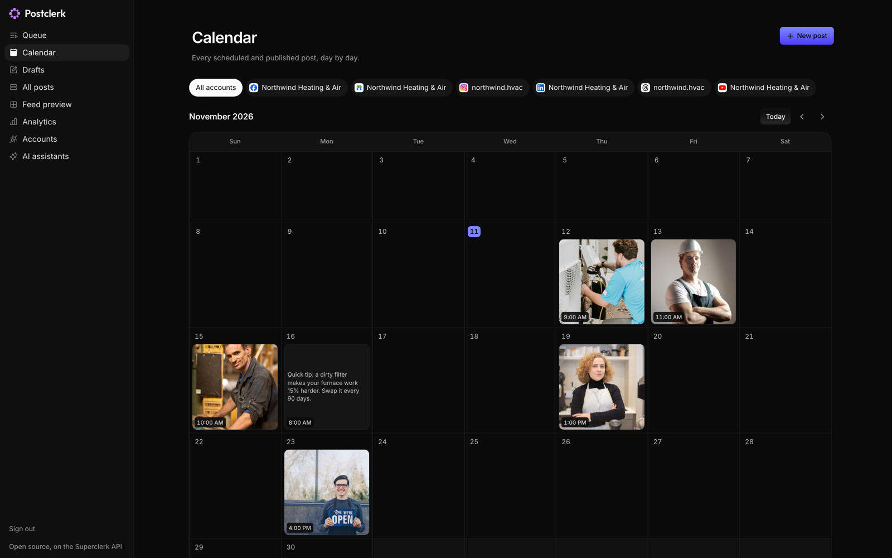

# Postclerk

Schedule posts to Instagram, Facebook, LinkedIn, Threads, TikTok, YouTube and Google Business Profile from one calendar. Free and open source.

Use it at **[postclerk.io](https://postclerk.io)**, or deploy your own copy in one click:

[](https://deploy.workers.cloudflare.com/?url=https://github.com/superclerkhq/postclerk)



Postclerk runs on the [Superclerk API](https://docs.superclerk.com). There's no database to run and no developer app to register with each network: you sign in with Superclerk, connect your accounts through it, and your posts live in your Superclerk workspace.

## What's inside

- A queue, a calendar, drafts and an Instagram feed preview
- One composer for every network, with per-network captions, media and settings
- A media library, and analytics per account and per post
- Choose which pages and profiles each account posts to
- An MCP server, so Claude Code, Codex, Cursor or VS Code can draft and schedule posts for you

## Deploy your own

It takes about two minutes, and Cloudflare's free plan covers it.

1. Click **Deploy to Cloudflare** above and sign in to Cloudflare.
2. Connect GitHub or GitLab. Cloudflare creates a copy of this repo in your account.
3. Cloudflare asks for one secret, `SESSION_SECRET`. Paste any long random string: `openssl rand -base64 32` makes one. Leave `SUPERCLERK_URL` as it is.
4. Deploy, then open the address Cloudflare gives your Worker (it ends in `workers.dev`) and click **Sign in with Superclerk**.

That's it. There's nothing to register with Superclerk, because your copy introduces itself when someone signs in ([How sign-in works](#how-sign-in-works) explains how). Every push to your copy's `main` branch redeploys it.

To use your own domain, open the Worker in Cloudflare and add it under **Settings → Domains & Routes**. Changing `SESSION_SECRET` later signs everyone out.

Rather use the terminal? With [Bun](https://bun.sh):

```sh
bun install
bun run deploy
openssl rand -base64 32 | bunx wrangler secret put SESSION_SECRET
```

## Run it locally

```sh
bun install
echo "SESSION_SECRET=$(openssl rand -base64 32)" > .dev.vars
bun run dev
```

Open <http://localhost:5173> and sign in. Superclerk can't reach your computer to read its address, so a local copy signs in as postclerk.io, which allows sending you back to localhost.

The screens live in `src/components/social`, and the whole server is one file, `worker/index.ts`, built on [Hono](https://hono.dev). `bun test` runs its tests, and `bun run typecheck` checks the types; CI runs both on every push.

## How sign-in works

Clicking **Sign in with Superclerk** sends you to Superclerk with a request like this (spaces and line breaks added):

```
https://api.superclerk.com/oauth/authorize
  ?client_id=https://postclerk.io/oauth/client.json
  &redirect_uri=https://postclerk.io/oauth/callback
  &scope=social:write connections:write
  &apps=instagram facebook-page linkedin-profile linkedin-page threads tiktok youtube google-business-profile
  &code_challenge=…&state=…
```

- **`client_id` is a URL.** Superclerk fetches it and reads the app's [client metadata document](https://datatracker.ietf.org/doc/draft-ietf-oauth-client-id-metadata-document/): its name and the addresses it may send you back to. That's why no copy needs registering, and why the approval page names the app by its domain.
- **`scope` is what the app may do.** `social:write` covers social accounts, posts, media and analytics. `connections:write` covers connecting accounts. Each includes reading.
- **`apps` narrows it to these networks.** The approval page shows their logos, and the key only sees connections from those apps and can only connect those. LinkedIn shows twice because personal profiles and company pages are separate apps.
- **Allow sends you back with a one-time code.** The Worker trades it, along with a [PKCE](https://oauth.net/2/pkce/) verifier only it knows, for an API key with exactly that access.

Only workspace admins can approve. Signing out of Postclerk revokes the key. So does removing it in Superclerk under Settings, Developer API, and Postclerk then returns to its sign-in screen on its next call. `SCOPE` and `APPS` sit at the top of `worker/index.ts`.

The Worker itself keeps nothing:

```
Browser or AI assistant → worker/index.ts on Cloudflare → api.superclerk.com
```

Your key is encrypted with `SESSION_SECRET` into a cookie that lasts a year, as a standard encrypted JWT ([JWE](https://www.rfc-editor.org/rfc/rfc7516), with [jose](https://github.com/panva/jose)). Page scripts can't read it, and the browser sends it only with Postclerk's own requests, over HTTPS. On each call the Worker decrypts it and passes the call on to Superclerk, which enforces the key's scopes. This is the [backend-for-frontend pattern](https://datatracker.ietf.org/doc/html/draft-ietf-oauth-browser-based-apps) for browser apps.

## AI assistants

Postclerk is also an MCP server, at `/mcp`. Its **AI assistants** page gives you a token and a ready command for each client:

```sh
claude mcp add --transport http postclerk https://postclerk.io/mcp --header "Authorization: Bearer <token>"
```

Assistants can do what your sign-in allows: list your accounts, media and posts, create, edit, reschedule, publish and cancel posts, and connect accounts. Signing out of the browser the token came from disconnects them.

claude.ai and ChatGPT need OAuth on the MCP server itself, which Postclerk doesn't offer yet. Assistants can attach media you've already uploaded, but can't upload new files.

## Build on the API

Everything here is the public [Superclerk API](https://docs.superclerk.com/social), so your own code can do the same:

```ts
import { Superclerk } from "@superclerk/sdk"

const superclerk = new Superclerk() // reads SUPERCLERK_API_KEY
const { accounts } = await superclerk.social.accounts.list()
const threads = accounts.find((account) => account.platform === "threads")!
await superclerk.social.posts.create({
  content: "Open this Saturday for emergency calls.",
  mediaItems: [],
  platforms: [{ accountId: threads.id, platform: "threads", platformSpecificData: {} }],
  scheduledFor: "2026-11-21T09:00:00-05:00",
})
```

## Good to know

- Posts go out through Superclerk's approved apps on each network, so their limits apply. TikTok, for example, requires the creator to review each post, which the composer does. Keep that screen if you change the composer.
- Turning on analytics for an account, and TikTok inbox uploads, still happen in the Superclerk app. Postclerk links you there.
- Uploads pass through Cloudflare, which takes up to 100 MB per file. Put bigger files in Superclerk's media library, and Postclerk finds them there.

## License

[MIT](./LICENSE). The Claude Code and Codex logos come from [LobeHub Icons](https://github.com/lobehub/lobe-icons), also MIT. Each mark belongs to its owner.
